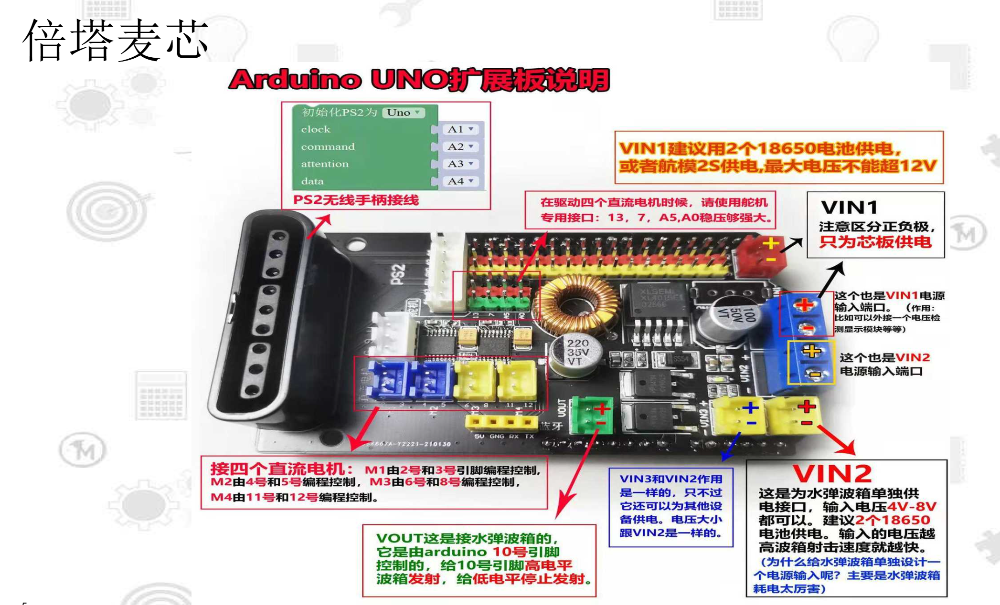
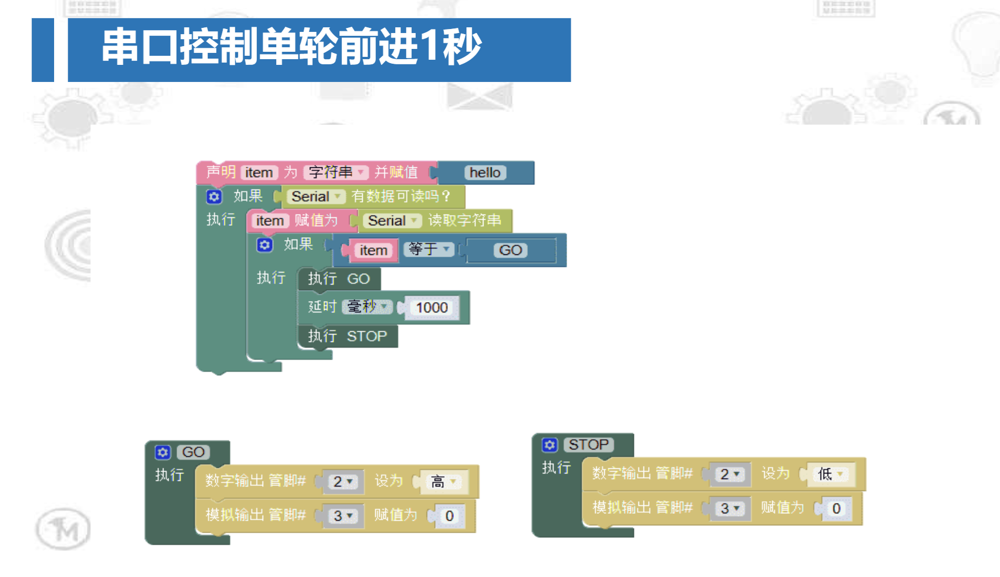
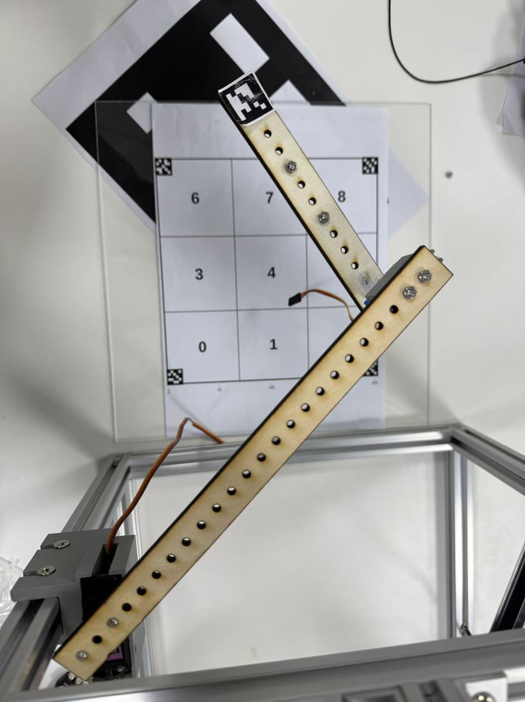
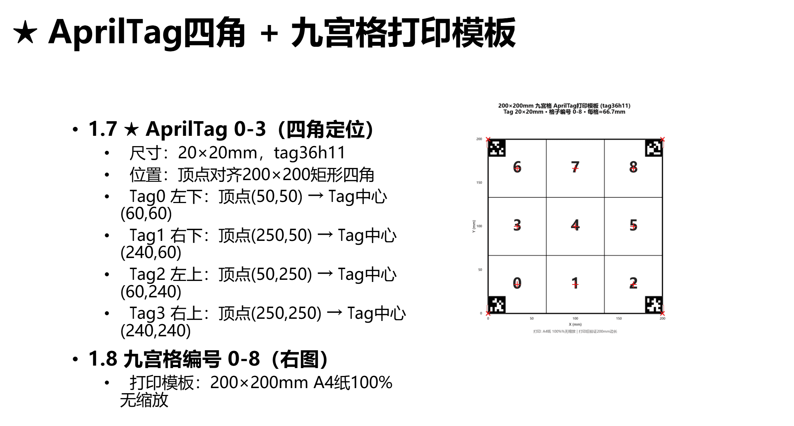
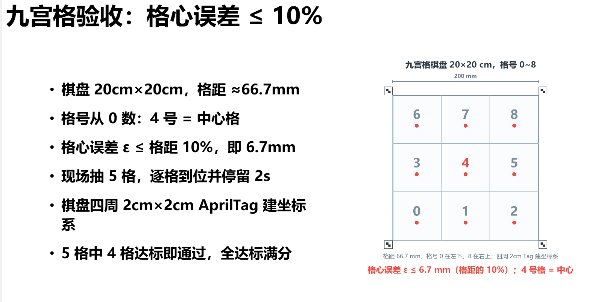
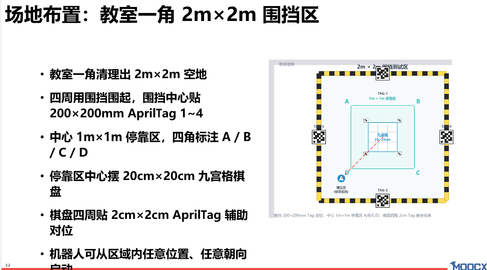

## 项目题目：银立方 + MHS 自动实验室机器人
- 硬件： 银立方麦轮底盘上加装机械臂，构成具身实验机器人
- 实现 MHS 协议基本功能：能听（输入语音指令MHS.listen），能说（播报文本 MHS.say），能走（MHS.move） · 能做(MHS.arm 机械臂) · 能验（视觉验证）

## 主要模块：

1. 树莓派：机器人的大脑，写入所有程序，做位置识别，通过串口通信操作arduino操纵车轮，操作机械臂，做语言识别，语言播报，视觉识别

2. 4个电机，万向轮

树莓派通过串口模块， 操作arduino版指挥4个车轮，移动机器人；

电机结构：arduino uno + 扩展板 + 电机

串口通信示例：

所有电机的代码参数已经调好，放在`Agents/move/move_func.ino`, 供参考

3. 机械臂

机械臂不执行抓取等动作，只需要将末端放到指定位置；

机械臂只在平面内转动，两个自由度，电机位置如下图；

机械臂在九宫格（如下图）行动，俯视摄像机根据九宫格四角和机械臂末端的apriltag将机械臂末端放到0-8格中心（误差 < 6.7 mm）

4. 语言接受，处理与识别

    这部分由别人完成，最终提供一个接口，接口接受语言，处理，返回固定格式的指令；
    - 返回（格数: str, 动作: str）
    - 3类动作：运功动作和机械臂动作
        - 运动动作（A/B/C/D, 动作编码）
        - 机械臂动作 （0-8 ， 动作编码）
        - (None, None)：不做动作
        - 动作编码：arrive = 到达，其余待补充
    - 可能拓展

    这部分接口代码已实现，放在`Agents/listen_speak`, 可参考其中的代码与文档

    注意，接受返回的动作后，你需要代码在树莓派端做出如下判断：
    - 若指令是字母 + 到达，意味着应该驱动车轮前往地点
    - 若指令是数字 + 到达，意味着应该驱动机械臂，将机械臂末端放在对应格子

5. Apriltag + AHRS + IMU 定位

详细功能说明如下：
    1. 系统开机，机器人置于坐标原点，IMU校准，随后机器人置于任何位置时，它能通过IMU知道自己的坐标；
    2. 系统将最终的实验场地坐标系放入程序，系统知道ABCD与九宫格的坐标
    3. 借助 AprilTag 1~4 辅助定位

6. 避障：前后左右4个超声波模块

## 测试方法：

任意位置口令 → 格心到位
- 将银立方放到场地内任意位置（朝向任意）
- 口令「请到九宫格的 4 号位置」→ 机械臂触达格心
- 口令「请移动到 A 点」→ 导航到停靠区 A 角
- 原地旋转扫描 AprilTag 1~4，解算自身位姿
- 2 自由度机械臂伸缩到指定格（4 号 = 中心，从 0 数）
- 连续测试：A/B/C/D 间移动 + 触达多格，无需人工搬动

## 编程规范

- 必须遵循以下内容
- 杜绝防护性编程，编码要易于阅读，维护，要有合格的变量名与完善的中文注释
- 生成的所有文件放在/Agengts 文件夹内，按模块分模块文件放在四个字文件夹中 /move，/arm，/vision，/listen_speak
- 同步维护4个模块的文档与一份系统（模块整合）文档，文档中简洁地介绍代码的原理，详细地介绍代码怎么使用
- 注意合适的命名规范，文件名应当简洁明了
- 编程中遇到任何问题，需要更多额外信息，应该向用户提问

