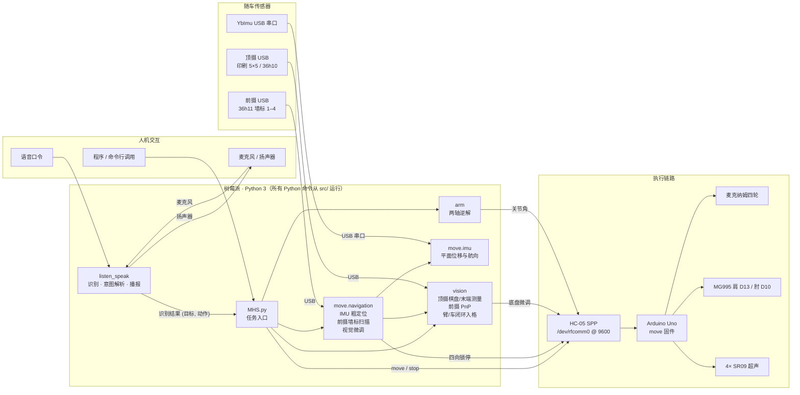

# Smart-Robotic-Arm · 银立方实验机器人

树莓派通过 HC-05 蓝牙控制 Uno。Uno 驱动麦克纳姆四轮底盘、两台 MG995 舵机并轮询四个 SR09 避障探头。小车用 IMU 从启动零点出发，在目标附近扫描前摄墙标，测量车心并微调，遇障后锁停。随车顶摄用于九宫格、机械臂末端和车体定位。

## 项目架构



`MHS` 负责任务分派，`move`、`vision`、`arm`、`listen_speak` 提供具体能力；底盘与关节命令经 HC-05 交给 Uno，两台相机和 IMU 各自通过 USB 接入树莓派。各模块的调用关系与返回格式见[系统接口手册](docs/API.md)和[模块入口](docs/README.md)。

## 快速开始

### 1. 无硬件测试

任意装有 Python 3 的电脑都可运行，只使用标准库：

```sh
cd src
python -m move go --ms 250 --dry-run
```

终端应打印 `GO 250`。这一步不打开串口，也不驱动车轮。

### 2. 树莓派安装依赖

首次接线、系统准备和 Uno 烧录见[树莓派部署指南](docs/DEPLOY_RASPBERRY_PI.md)。系统与接线就绪后，在树莓派克隆仓库并安装底盘、视觉依赖：

```bash
git clone https://github.com/cabeL001-cpu/Smart-Robotic-Arm.git "$HOME/Smart-Robotic-Arm"
cd "$HOME/Smart-Robotic-Arm/src"
python3 -m venv "$HOME/.venvs/smart-robotic-arm"
source "$HOME/.venvs/smart-robotic-arm/bin/activate"
python -m pip install -r move/requirements.txt -r vision/requirements.txt
python -m move go --ms 250 --dry-run
```

需要语音时再安装 `-r listen_speak/requirements.txt`，模型与麦克风配置见[语音模块说明](docs/listen_speak/README.md)。离线单测与样例图像检查见部署指南的「离线自检」。

### 3. 连接实车

先完成 [HC-05 配对](docs/BLUETOOTH_WORKFLOW.md)，再绑定串口。以下命令都在 `src/` 下运行：

```bash
sh bt_link.sh bind sjtu013
python -m move stop
python -m move.sonar scan
```

`move stop` 应打印「Uno 已确认停车。」，`sonar scan` 应依次列出前、后、左、右四个探头地址。开动前先完成[小车标定](docs/move/CALIBRATION.md)和[机械臂标定](docs/arm/CALIBRATION.md)。

> 实车动作前架空四轮并确认场地畅通。Uno 与树莓派通过 USB 相连时不要驱动舵机；机械臂舵机必须由车载主电源供电。

## 文档索引

| 文档 | 内容 |
| --- | --- |
| [系统集成与模块入口](docs/README.md) | 链路验收、各模块入口与共用 Uno 连接 |
| [系统接口手册](docs/API.md) | 导航、底盘、机械臂、视觉、IMU、语音的调用与返回格式 |
| [树莓派部署指南](docs/DEPLOY_RASPBERRY_PI.md) | 接线、系统与依赖、蓝牙配对、Uno 烧录、自检、故障定位 |
| [HC-05 配对与验收](docs/BLUETOOTH_WORKFLOW.md) | 配对、绑定 `/dev/rfcomm0`、停车回执检查 |
| [标定实践记录](docs/CALIBRATION_PRACTICE.md) | 顶摄、机械臂和闭环入格的实测过程与误差记录 |
| [小车标定与运行](docs/move/CALIBRATION.md) | A/B/C/D 与任意坐标、前摄、IMU、轮速和避障参数 |
| [四轮与避障说明](docs/move/README.md) | Uno 固件、接线、点动测试和四向超声 |
| [IMU 采样与回放](docs/move/imu/README.md) | YbImu 采样、记录、回放与视觉位姿修正 |
| [南侧验收路线](docs/move/SOUTH_ROUTE.md) | 固定路线的坐标、命令和验收指标 |
| [墙标闭环路线](docs/move/TAG_ROUTE.md) | 前摄墙标测距直行与 IMU 转向 |
| [相机设置与视觉示例](docs/vision/README.md) | 顶摄/前摄取流、角标识别、测量和闭环命令 |
| [机械臂接口](docs/arm/README.md) | 两轴规划、关节输出与独立运行 |
| [机械臂使用示例](docs/arm/USAGE.md) | 常用命令与调用示例 |
| [机械臂标定与到位](docs/arm/CALIBRATION.md) | 两轴限位、顶摄指尖标定和九宫格到位 |
| [语音接口与自测](docs/listen_speak/README.md) | 语音识别、意图解析、播报与自测 |
| [总控流程与现场操作](docs/TASK.md) | `task.py` 总控：唤醒、口令解析、南侧路线、闭环入格与验收清单 |

## 代码索引

| 路径 | 职责 |
| --- | --- |
| [`src/MHS.py`](src/MHS.py) | 任务级入口：`listen`、`say`、`move`、`arm`、`open_uno`、`open_navigation`、`dispatch` |
| [`src/task.py`](src/task.py) | 总控入口：唤醒 → 口令解析 → 南侧路线 → 闭环入格，全程语音播报 |
| [`src/uno.py`](src/uno.py) | HC-05/Uno 串口、回执超时与断线重连 |
| [`src/move/__main__.py`](src/move/__main__.py) | 四轮动作命令，如 `python -m move go/stop/m1…` |
| [`src/move/navigation.py`](src/move/navigation.py) | 启动零点导航：IMU 粗定位、前摄整圈扫描、停车后视觉微调 |
| [`src/move/imu/`](src/move/imu/) · [`heading.py`](src/move/heading.py) | IMU 采样/回放、航向保持直行与原地转向 |
| [`src/move/move.ino`](src/move/move.ino) · [`move_func.ino`](src/move/move_func.ino) · [`arm_control.ino`](src/move/arm_control.ino) | Uno 固件：四轮、两轴舵机、四向超声与受阻锁停 |
| [`src/move/board_route.py`](src/move/board_route.py) · [`tag_route.py`](src/move/tag_route.py) · [`south_route.py`](src/move/south_route.py) | 九宫格周围路径、墙标闭环路线和南侧验收脚本 |
| [`src/move/tag_route_pose_record.py`](src/move/tag_route_pose_record.py) | 前摄墙标闭环测距与位姿记录（南侧路线三阶段旁路记录） |
| [`src/vision/`](src/vision/) | 取流、标签/印刷角标检测、单应与平面；顶摄测末端和车心，臂/车闭环入格，前摄 PnP 测车心 |
| [`src/arm/`](src/arm/) | 两轴逆解、关节限位、独立点动与格心规划 CLI |
| [`src/listen_speak/`](src/listen_speak/) | Vosk 识别、口令解析、Piper/Edge TTS 播报 |
| [`src/bt_link.sh`](src/bt_link.sh) | 把已配对的 HC-05 绑定成 `/dev/rfcomm0` |
| [`src/board_targets.json`](src/board_targets.json) · [`src/vision/board_reference.json`](src/vision/board_reference.json) | 九宫格印刷数字目标和车体重定位参考像素 |
| [`src/move/calibration/`](src/move/calibration/) · [`src/move/arm_limits.h`](src/move/arm_limits.h) | 导航/前摄/场地参数与 Uno 舵机限位 |

`src/move` 同时是 Arduino 草图目录，目录名必须保留为 `move`；`move.ino`、`move_func.ino`、`arm_control.ino` 和 `sonar.cpp` 由 Arduino 合并编译。测试夹具位于 `src/vision/fixtures/`，Uno 台架测试位于 `src/move/tests/`。